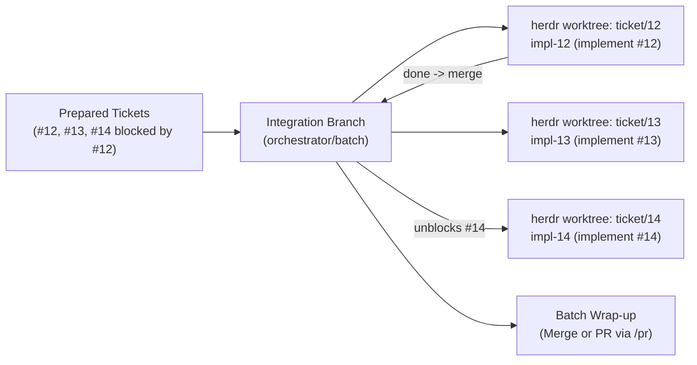

# orchestrator-skill (Herdr + Matt Pocock `implement`)

[](./LICENSE)
[](https://herdr.dev)
[](https://github.com/Dawe1600/orchestrator-skill)

A non-blocking dispatcher skill for **Herdr** that distributes pre-prepared tickets evenly across parallel AI coding agents (`agy`, `claude`, `codex`, `gemini`) running **Matt Pocock's `implement` workflow** inside isolated Git worktrees.

> Forked from [olivieropinotti/orchestrator-skill](https://github.com/olivieropinotti/orchestrator-skill) and rebuilt around `herdr worktree`, `herdr agent`, dependency-aware batching, and clean context resets between tickets.

---

## How It Works



1. **Reads the ticket queue** from your configured tracker (`docs/agents/issue-tracker.md` via `gh`, `glab`, or `.scratch/`) or from explicit IDs you pass (`#12 #13 #14`).
2. **Respects `blocked by` dependencies:** only unblocked tickets enter the active queue; blocked ones wait in the ledger.
3. **Creates an integration branch** (`orchestrator/batch`) and spawns up to **3-4 parallel workers**, each in its own `herdr worktree` (`ticket/<nr>`) with `--no-focus`.
4. **Runs `implement #<nr>`** on every worker (`tdd`, typecheck/tests, `code-review`, local commit on `ticket/<nr>`).
5. **Tracks state in `.herdr/orchestrator.md`** and returns control immediately so your main session never blocks.
6. **Merges finished blockers** into `orchestrator/batch`, **resets worker contexts** (`ctrl+c`), and **dispatches newly unblocked tickets** in parallel.

---

## Prerequisites

- **Herdr** (`HERDR_ENV=1` in the main session) with at least one supported agent CLI installed (`agy` by default, or `claude`, `codex`, `gemini`, etc.).
- Repository prepared with **`setup-matt-pocock-skills`** (`docs/agents/issue-tracker.md` present) and pre-created tickets.
- Matt Pocock's core engineering skills installed (`implement`, `tdd`, `code-review`, `pr`).

---

## Installation

### Option A: Using `skills` CLI
```bash
npx skills add Dawe1600/orchestrator-skill
```

### Option B: Manual global install
Copy `skills/orchestrator/SKILL.md` into your global skills directory:

- **Antigravity / Gemini:** `~/.gemini/config/skills/orchestrator/SKILL.md`
- **Claude Code:** `~/.claude/skills/orchestrator/SKILL.md`

---

## Usage

Start the orchestrator once (with `/orchestrator` or natural language):

```text
/orchestrator #12 #13 #14 #15
/orchestrator rozdziel tickety
/orchestrator #12 #13 #14, use claude, max 3 workers
```

Once active, control it with plain messages (**no leading `/`**):

| Command | Effect |
| :--- | :--- |
| `status` / `sync` | Inspect `herdr agent list` + `herdr agent read`, update `.herdr/orchestrator.md`, merge finished blockers, reset contexts, and advance the queue |
| `next` | Advance idle/finished workers to the next queued tickets |
| `use <kind>` | Switch default `--kind` for new workers (`agy`, `claude`, `codex`, `gemini`) |
| `redirect <name> to ...` | Send a follow-up instruction to a running worker |
| `stop <name>` / `stop all` | Interrupt worker(s) with `ctrl+c` and mark `[stopped]` |
| `stop orchestrating` | Exit orchestrator mode |

---

## Ledger Format (`.herdr/orchestrator.md`)

```markdown
# Orchestrator Ledger

- Base branch: `main`
- Integration branch: `orchestrator/batch`
- Default kind: `agy`
- Queue: `#15`
- Blocked: `#16 (by #12)`, `#17 (by #12, #13)`

## Workers
- [running] impl-12 (agy, ws: w2, branch: ticket/12) - Implement auth middleware - started 11:50
- [done]    impl-13 (agy, ws: w3, branch: ticket/13) - Add rate limiter (commit a1b2c3d, tests pass) - 12:05
- [blocked] impl-14 (claude, ws: w4, branch: ticket/14) - Needs decision on schema migration - 12:08
```

---

## License

[MIT](./LICENSE)
